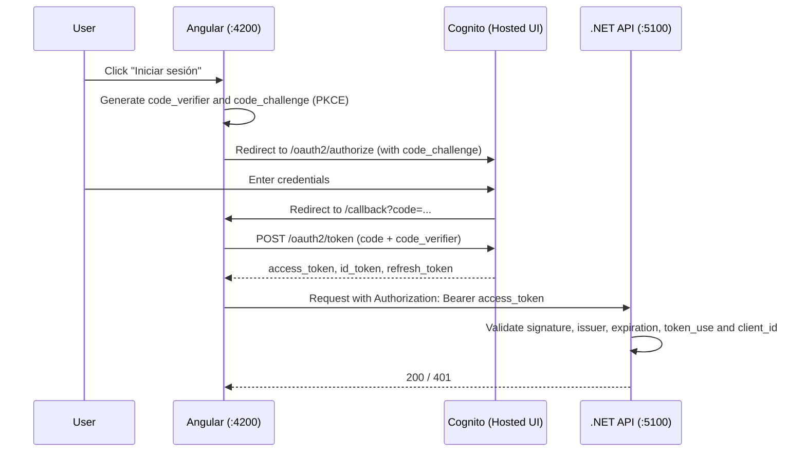

# AwsCognitoTest

A learning project to understand **authentication and authorization** with [Amazon Cognito](https://aws.amazon.com/cognito/). An Angular SPA signs in against Cognito (OIDC, Authorization Code + PKCE) and calls a .NET API that validates the access token (JWT) on every request.

> This is a test project: the functional domain (`Sample`) is a placeholder, just to have something to protect.

## Contents

- [Repository structure](#repository-structure)
- [How the login works](#how-the-login-works)
- [Backend](#backend)
- [Frontend](#frontend)
- [Cognito setup](#cognito-setup)
- [Running the project](#running-the-project)
- [Regenerating the API client](#regenerating-the-api-client)
- [Error format](#error-format)
- [Security](#security)
- [Pending work](#pending-work)

## Repository structure

```
AwsCognitoTest/
├── Backend/     .NET 10 solution (Clean Architecture)
└── Frontend/    Angular 22 SPA
```

## How the login works



Key points:

- The **access token** is what gets sent to the API. The **ID token** is only meant for the frontend to know who the user is, and the API rejects it on purpose.
- The App Client is **public** (no client secret): a SPA cannot keep secrets. **PKCE** is what protects the flow.
- The API **does not call Cognito on every request**: it downloads the User Pool's public keys (JWKS) once, caches them, and verifies the signature locally.

## Backend

A **.NET 10** solution in `Backend/`, following Clean Architecture. Detailed conventions live in [`Backend/CLAUDE.md`](Backend/CLAUDE.md).

### Layers and dependencies

```
API ──► Application ──► Domain
 └────► Infrastructure ──► Application, Domain
```

| Project | Responsibility |
|---|---|
| `AwsCognito.Test.Domain` | Entities, value objects and base exceptions (`AppException`, `ErrorKind`). No dependencies |
| `AwsCognito.Test.Application` | Services (`I<X>Service`), repository abstractions, DTOs and application exceptions. No EF Core, no HTTP |
| `AwsCognito.Test.Infrastructure` | EF Core (`AppDbContext`), entity configurations, repository implementations |
| `AwsCognito.Test.API` | Controllers, HTTP models, authentication, error handling, Swagger and `Program.cs` |

Each layer registers its services in an `Add<Layer>Module()` extension method, which `Program.cs` composes.

### Authentication in the API

It lives in `AwsCognito.Test.API/Authentication/`:

- **`CognitoOptions`**: region, User Pool ID and Client ID, read from the `Cognito` section of `appsettings.json` and validated on startup. The issuer is built as `https://cognito-idp.<region>.amazonaws.com/<userPoolId>`.
- **`AuthenticationExtensions`**: `AddCognitoAuthentication` configures `JwtBearer`, and `AddFrontendCors` enables the origins listed in `Cors:AllowedOrigins`.
- **`AuthErrors`**: codes and messages for the 401/403 errors.

What the API checks on each token:

| Check | How |
|---|---|
| Signature | Public keys discovered from `{issuer}/.well-known/openid-configuration` |
| Issuer (`iss`) | Must match the User Pool's issuer |
| Expiration (`exp`) | With a 1-minute tolerance |
| Token type | `token_use` must be `access` |
| Application | `client_id` must match the configured App Client |

> Cognito access tokens **do not include the `aud` claim**, they carry `client_id` instead. That is why `ValidateAudience` is turned off and `client_id` is validated manually in `OnTokenValidated`.

Every endpoint in `SamplesController` requires `[Authorize]`. The pipeline order in `Program.cs` matters: `UseCors` → `UseAuthentication` → `UseAuthorization`.

### Database

SQL Server with EF Core. The connection string (`ConnectionStrings:Default`) is in `appsettings.Development.json` and uses Windows authentication against a local instance (`Server=.`).

### Libraries

| Package | Purpose |
|---|---|
| `Microsoft.AspNetCore.Authentication.JwtBearer` | JWT validation |
| `Microsoft.EntityFrameworkCore` (+ `SqlServer`, `Design`, `Tools`) | Data access and migrations |
| `Swashbuckle.AspNetCore` | Swagger UI and `swagger.json` generation, with the **Authorize** button to test with a token |
| `Microsoft.AspNetCore.OpenApi` | ASP.NET Core OpenAPI support |

Versions are centralized in `Backend/Directory.Packages.props` (Central Package Management): `.csproj` files reference packages **without a version**, and floating versions are not allowed.

## Frontend

An SPA in `Frontend/` built with **Angular 22**, standalone components, and no routing or SSR for now.

```
Frontend/
├── ng-openapi-gen.json        API client generator config
└── src/app/
    ├── api/                   API client (GENERATED, do not edit)
    ├── auth/auth.config.ts    Cognito OIDC configuration
    ├── shared/                Shared utilities (ErrorMessageService)
    ├── app.config.ts          Providers: HttpClient, interceptor, OIDC, API client
    ├── config.ts              API base URL
    └── app.ts / app.html      Root component
```

### OIDC configuration

Defined in [`auth.config.ts`](Frontend/src/app/auth/auth.config.ts):

| Option | Value | What it does |
|---|---|---|
| `authority` | The User Pool's issuer | The library reads `openid-configuration` from it and discovers the login and token endpoints |
| `clientId` | App Client ID | Identifies the application |
| `redirectUrl` | `http://localhost:4200/callback` | Where Cognito returns after login. It must match the App Client's callback URL **exactly** |
| `scope` | `openid email` | Identity data requested |
| `responseType` | `code` | Authorization Code flow; the library applies PKCE |
| `useRefreshToken` / `silentRenew` | `true` | Renews the access token with the refresh token before it expires |
| `secureRoutes` | `<apiBaseUrl>/api` | The interceptor attaches the token **only** to URLs starting with this |

How it is wired in [`app.config.ts`](Frontend/src/app/app.config.ts):

- `provideAuth(authConfig)` registers the OIDC library.
- `provideHttpClient(withInterceptors([authInterceptor()]))` makes every `HttpClient` call go out with `Authorization: Bearer <access_token>` when the URL matches `secureRoutes`.
- `provideApiConfiguration(apiBaseUrl)` sets the generated client's base URL.

In `app.ts`, `checkAuth()` is called on startup: it processes the `?code=...` when Cognito redirects back, or restores the existing session. Tokens are stored in **`sessionStorage`** (the library's default).

### Libraries

| Package | Purpose |
|---|---|
| `@angular/*` 22 | Framework |
| `angular-auth-oidc-client` | OIDC client: PKCE, code exchange, refresh and interceptor |
| `ng-openapi-gen` (dev) | Generates the typed API client from `swagger.json` |
| `rxjs`, `tslib` | Angular dependencies |
| `prettier`, `typescript` (dev) | Formatting and compiler |

## Cognito setup

Resources this project expects, which you need to create in your own AWS account:

1. A **User Pool** with email sign-in and **self-registration disabled** (users are created manually in the console).
2. A **Hosted UI domain** (Cognito prefix domain): `https://<prefix>.auth.<region>.amazoncognito.com`.
3. An **App Client** of type **Single-page application**, i.e. **without a client secret** (this cannot be changed after the client is created):
   - Grant type: *Authorization code grant*
   - Scopes: `openid`, `email`, `profile`
   - Callback URL: `http://localhost:4200/callback`
   - Sign-out URL: `http://localhost:4200`
4. A test user.

The pool and client data is configured in **two places** that must be kept in sync:

| Data | Backend | Frontend |
|---|---|---|
| Region, User Pool ID, Client ID | `Backend/AwsCognito.Test.API/appsettings.json` (`Cognito` section) | `Frontend/src/app/auth/auth.config.ts` |

These are public identifiers, not credentials.

## Running the project

### Requirements

- [.NET SDK 10](https://dotnet.microsoft.com/download)
- Node.js LTS (tested with 24) and npm
- Local SQL Server (default instance, or adjust the connection string)
- The `dotnet-ef` tool: `dotnet tool install --global dotnet-ef`
- A Cognito User Pool configured as described above

### 1. Database

From `Backend/`:

```bash
dotnet ef database update -p AwsCognito.Test.Infrastructure -s AwsCognito.Test.API
```

To create a new migration:

```bash
dotnet ef migrations add <Name> -p AwsCognito.Test.Infrastructure -s AwsCognito.Test.API -o Database/App/Migrations
```

### 2. API

```bash
cd Backend/AwsCognito.Test.API
dotnet run --launch-profile http
```

It listens on `http://localhost:5100`, with Swagger at `/swagger` (Development only).

### 3. Frontend

```bash
cd Frontend
npm install
npm start
```

It listens on `http://localhost:4200`. If you use the API's `https` profile, change `apiBaseUrl` in `Frontend/src/app/config.ts` to `https://localhost:7100`: a request to `http://localhost:5100` would be redirected to https and the browser would block it at the CORS preflight.

### Testing the API from Swagger

Open `/swagger`, click **Authorize**, and paste **only** the access token (without the word `Bearer`). You can copy it from DevTools → Network → the response of `POST .../oauth2/token` (`access_token` field). It lasts 1 hour.

## Regenerating the API client

The code in `Frontend/src/app/api/` is generated by [`ng-openapi-gen`](https://github.com/cyclosproject/ng-openapi-gen) from the API's `swagger.json`. **Do not edit it by hand**: every regeneration overwrites it, and removes files that no longer apply.

When the API contract changes (endpoints, routes, parameters or DTOs):

1. Start the API in Development (`swagger.json` is only exposed there).
2. From `Frontend/`:

```bash
npm run gen:api
```

Input and output are configured in [`Frontend/ng-openapi-gen.json`](Frontend/ng-openapi-gen.json): `input` is `http://localhost:5100/swagger/v1/swagger.json` and `output` is `src/app/api`. If the backend changes a DTO, the frontend stops compiling wherever it is affected, which is exactly the point.

Keep the `api/` folder under version control so the project builds without the API running.

Usage from a component:

```ts
import { Api } from './api/api';
import { apiSamplesPost$Json } from './api/fn/samples/api-samples-post-json';

const created = await this.api.invoke(apiSamplesPost$Json, { body: { name } });
```

> Function names come out long (`apiSamplesPost$Json`) and there is a `json` and a `plain` variant per endpoint, because the controllers declare neither an `operationId` nor `[Produces("application/json")]`. This is listed under [Pending work](#pending-work).

## Error format

Every API error, authentication errors included, has the same shape (`ProblemDetails`): `type` is a stable code, `title` is the category and `detail` is the message.

| Case | Status | `type` |
|---|---|---|
| No token | 401 | `auth.missing_token` |
| Expired token | 401 | `auth.token_expired` |
| Invalid token (badly copied, ID token, another app) | 401 | `auth.invalid_token` |
| No permission | 403 | `auth.forbidden` |
| Business errors (`AppException`) | 400 / 404 / 409 | own code, e.g. `sample.not_found` |
| Unexpected error | 500 | no `detail`, on purpose |

Business errors are translated by `AppExceptionHandler`, the only place that maps `ErrorKind` to an HTTP status. The 401/403 responses are written directly by the authentication middleware (`AuthErrors`). In the frontend, `ErrorMessageService` shows the `detail` (or `title`) returned by the API.

## Security

- **There are no credentials in the repository.** The configuration values (region, User Pool ID, Client ID, domain) are public identifiers: they show up in the browser's JavaScript and in the login URLs.
- The App Client is public and has no secret; the connection string uses Windows authentication.
- If you later add IAM keys, a client secret or database credentials, **do not put them in `appsettings.json`**: use `dotnet user-secrets` in development and environment variables or AWS Secrets Manager in production.
- Tokens are kept in `sessionStorage`, which is readable from JavaScript: an XSS vulnerability could steal them.
- CORS only allows the origins in `Cors:AllowedOrigins`. CORS is enforced by the browser and **does not protect the API** from other clients; that protection is the JWT.

## Pending work

- [ ] **Logout.** Cognito does not expose an `end_session_endpoint`, so the redirect to `/logout?client_id=...&logout_uri=...` on the Hosted UI has to be done by hand.
- [ ] **Role-based authorization**: Cognito groups (`cognito:groups`) mapped to roles and policies. The 403 path is implemented but **untested**, since there are no policies yet.
- [ ] Routing, a route guard and a dedicated examples page (everything is in the root component today).
- [ ] `GET /api/samples` to list items.
- [ ] `operationId` and `[Produces("application/json")]` on the controllers, for a cleaner generated client.
- [ ] Vulnerability warnings in transitive dependencies (`Microsoft.OpenApi`, `System.Security.Cryptography.Pkcs`): pin newer versions in `Directory.Packages.props`.
